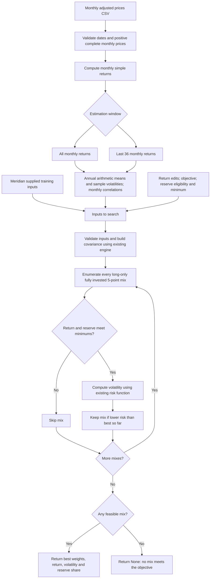

# Lab 15 — Portfolio Stability

## D — Decision

Which mix carries the least risk while meeting the mandate — and does the answer survive a one-point change in one estimate?

The app minimizes estimated annual volatility among fully invested, long-only portfolios on a 5-percentage-point weight grid. It enforces the expected-return objective and reserve floor. This is a grid minimum under an estimated model, not a guarantee of future performance or full mandate compliance.

## R — Universe and mandate

### Meridian training case

The decision user is Meridian Foundation's CIO. The Lab 13 horizon is seven years, with annual rebalancing and a 40% IG bond / 60% global equity benchmark. The classroom objective is 6.50% (a labelled 2.50% CPI estimate plus 4 points); the reserve floor is 3%. Bills and the 10-year Treasury note are reserve eligible. The 5-point grid means a positive 3% reserve floor requires at least 5% in eligible assets.

Inputs are the instructor's four Lab 14 sleeves and correlation table, stored in [portfolio.py](portfolio.py). They are training assumptions, not historical observations. The app does not establish the actual mandate's net-of-costs rolling-five-year objective, turnover, issuer concentration, broader liquidity rules, or undefined calendar-year loss rule.

### Personal Project 2 case

| Item | Required evidence |
|---|---|
| Universe | NVDA / MSFT / TSM / QCOM: four individual equity securities in the student's AI/semiconductor theme |
| Objective | 10.00% annual expected return, gross of fees; a student-selected hurdle, not a guaranteed or established institutional standard |
| Hard constraint | No additional constraint stated; long-only, fully invested, no borrowing/shorting, 5-point weight grid; reserve minimum 0%, no asset marked reserve eligible |
| Prices | 61 monthly adjusted closes from September 30, 2021 through September 30, 2026, generating 60 monthly returns |
| Provenance | Yahoo Finance daily adjusted-close responses downloaded October 22, 2026; actual retrieval timestamps and hashes in price-provenance.json |

| Ticker | Price field | Source URL | Actual download date | First / last observation |
|---|---|---|---|---|
| NVDA | Daily Adj Close, last session per month | [Yahoo NVDA history](https://finance.yahoo.com/quote/NVDA/history/) | 2026-10-22, 17:37:16 UTC | 2021-09-30 / 2026-09-30 |
| MSFT | Daily Adj Close, last session per month | [Yahoo MSFT history](https://finance.yahoo.com/quote/MSFT/history/) | 2026-10-22, 17:37:16 UTC | 2021-09-30 / 2026-09-30 |
| TSM | Daily Adj Close, last session per month | [Yahoo TSM history](https://finance.yahoo.com/quote/TSM/history/) | 2026-10-22, 17:37:17 UTC | 2021-09-30 / 2026-09-30 |
| QCOM | Daily Adj Close, last session per month | [Yahoo QCOM history](https://finance.yahoo.com/quote/QCOM/history/) | 2026-10-22, 17:37:17 UTC | 2021-09-30 / 2026-09-30 |

[prices.csv](prices.csv) contains only date and the four ticker columns, oldest first. [download_prices.py](download_prices.py) fetches daily adjusted closes and selects the last actual trading date each month. [price-provenance.json](price-provenance.json) records exact request URLs, retrieval times, and SHA-256 hashes for the CSV and saved [raw source responses](sources/). Yahoo describes adjusted close as accounting for splits and dividends in its [adjustment-method explanation](https://in.help.yahoo.com/kb/adjusted-close-sln28256.html). These are adjustment factors available at retrieval, not reconstructed point-in-time historical vintages.

The CSV estimator uses simple monthly adjusted-price returns, arithmetic monthly mean × 12, sample monthly standard deviation (ddof=1) × √12, and correlations of the same monthly returns. All-month estimates use every complete interval; last-36 estimates use the final 36 **returns**, requiring 37 prices. These are historical estimates, not forecasts; costs are not deducted. Missing, nonpositive, nonfinite, unordered, duplicate-month, or nonconsecutive-month prices are rejected rather than filled. Source data must be checked for splits/dividend adjustment and five-year coverage.

## I — Implementation and flowchart

[app.py](app.py) imports [portfolio.py](portfolio.py), including the Meridian inputs, estimator, and search. The app contains no portfolio return, covariance, or volatility calculation. The Lab 14 engine has been carried into this Lab 15 folder so the submission is self-contained; Lab 14's original files remain its archived submission. The engine's printed Lab 14 report is unchanged byte for byte.

From the repository root, using the installed course environment:

```powershell
.\.venv\Scripts\python.exe projects\lab-15-portfolio-stability\portfolio.py
.\.venv\Scripts\python.exe -m streamlit run projects\lab-15-portfolio-stability\app.py
.\.venv\Scripts\python.exe projects\lab-15-portfolio-stability\verify_lab15.py
.\.venv\Scripts\python.exe projects\lab-15-portfolio-stability\analyze_personal.py
```

Alternatively, from this lab folder with the correct Python environment active: `python portfolio.py`, then `python -m streamlit run app.py`. Open the terminal's Local URL. For the engine-link probe, edit both IG–equity source cells, save, then refresh or click **Reload engine inputs**. Restore both cells to 0.25 afterward.

For the personal case, tick **Use my saved Project 2 prices.csv** in the sidebar: this loads the sourced CSV and starts the objective at 10% and reserve floor at 0%. Toggle **Use last 36 monthly returns** for the window comparison. On all months, decrease the TSM return box by exactly 1.00 percentage point for the partner stress. The upload control remains available for another CSV.



The app runs the same search twice: current inputs and original loaded estimates. Both use the current objective and reserve eligibility/minimum; CSV loaded estimates always use all months. Largest change is the maximum absolute difference between corresponding asset weights, in percentage points. It is unavailable when either mix is infeasible. The window toggle also changes volatility and correlations, so its result is a joint estimation-window stress, not just a mean-return stress.

**Recursion clarification:** `allocations(20, 4)` chooses the first asset's units from 0 through 20, then distributes the remaining units across three assets. This repeats until the final asset gets exactly the remaining units. Each ordered allocation has exactly one path, so the search covers all 1,771 four-asset grid mixes without duplicates; weights always sum to 20 units = 100%. The first evaluated mix is retained when risk values differ by no more than 1e-12; the ordering is asset insertion order and ascending unit counts.

## V — Known-answer verification

Weight order: **bills / 10-year / IG / equity**. Return and volatility are annual percentages. The app values below were checked with Streamlit's AppTest, not typed into the app.

| Executed run | Weights (%) | Return (%) | Volatility (%) | Reserve (%) |
|---|---|---:|---:|---:|
| Meridian as loaded | 0 / 20 / 25 / 55 | 6.51 | 9.44 | 20.00 |
| Equity return 8.0% → 7.0% | 0 / 10 / 10 / 80 | 6.53 | 12.94 | 10.00 |
| IG–equity correlation 0.50 in both engine cells | 0 / 40 / 0 / 60 | 6.52 | 9.73 | 40.00 |

The one-percentage-point reduction in equity's estimated return moves equity from 55% to 80%: **25 percentage points**, or a quarter of the portfolio. The 10-year and IG weights fall by 10 and 15 points. Estimated volatility rises by 3.50 points. The return shown for each mix uses that run's own assumptions, so 6.53% is not an improvement under identical estimates.

The engine-link test changes actual source text in an isolated temporary app package, executes the Streamlit page in a fresh process, and checks the changed answer and weights. Both delivered correlation cells remain restored to 0.25. The original Lab 14 and new Lab 15 command outputs were compared byte for byte. Infeasible return and reserve cases, the editable return control, and independent CSV formulas were also checked. Synthetic prices appear only inside software tests; they are not used as the personal investment data.

Reproduce with [verify_lab15.py](verify_lab15.py); the saved [verification-results.txt](verification-results.txt) records execution. Automated page checks do not stand in for the student's live browser and partner exercises.

## Personal universe — all months versus last 36

Both runs use the sourced CSV, 10.00% objective, and 0% reserve minimum. The all-month case uses 60 monthly returns ending September 2026; the recent case uses 36 monthly returns for October 2023–September 2026. No return box edits are applied during this window comparison. Weight order is NVDA / MSFT / TSM / QCOM.

| Run | Objective / reserve rule | Weights or honest infeasibility | Return | Volatility | Reserve |
|---|---|---|---|---|---|
| All months | 10.00% / 0% | 0 / 70 / 25 / 5 | 21.55% | 24.82% | 0.00% |
| Last 36 returns | Same mandate | 0 / 55 / 45 / 0 | 39.62% | 21.69% | 0.00% |

**Largest weight change: 20 percentage points**, in TSM (25% → 45%); MSFT falls 15 points and QCOM falls 5. NVDA remains 0%. The personal optimizer is allowed to assign zero to a universe asset; an NVDA-centered theme does not require a positive NVDA weight under the supplied mandate.

The window shift changes covariance estimates. TSM volatility falls from 36.78% to 30.77%, and its correlation with MSFT falls from 0.3115 to 0.0769. This supports more TSM in the lower-risk mix. The displayed return estimate rises substantially, but the estimates describe different historical windows and are not forecasts. [personal-results.md](personal-results.md) contains all individual estimates and correlation matrices; [personal-results.json](personal-results.json) preserves unrounded results. Reproduce with [analyze_personal.py](analyze_personal.py), which imports the engine and checks source hashes.

## Explain the code and partner attack

The student reports completing the no-AI line-by-line explanation. The search defines the 20 available 5-point units, recursively allocates all 20 across the assets, rejects mixes below the return or reserve floors, evaluates survivors with the existing risk function, and retains the lowest-risk candidate. Returning `None` means the grid contains no qualifying mix.

1. **Partner's record, supplied by student:** NVDA, MSFT, TSM, QCOM; 10.00% annual return hurdle; long-only, fully invested, 5-point grid; no reserve constraint (0%).
2. **Independent explanation:** student reports explaining the search line by line without AI. AI has not observed this activity.
3. **Partner's question, supplied by student:** Why does `result_return + 1e-12 < objective` add a tolerance, and could it admit a sub-hurdle portfolio? Binary floating-point arithmetic can place an exact mathematical boundary slightly below its intended value, so the tolerance prevents false rejection. The comparison does allow a shortfall up to 1e-12 in decimal return, or 0.0000000001 percentage points; it is a tiny numerical allowance, not a material relaxation. For a rounding example, `0.1 + 0.2` is a better illustration than `0.05 + 0.05`, which Python displays as `0.1`.
4. **Partner's chosen attack, supplied by student:** reduce TSM's historical annual return estimate by 1.00 percentage point. The partner's stated concern was geopolitical concentration and foreign-fab capital spending; this is a reported rationale, not an independently quantified forecast adjustment. The supplied 18% → 17% figures were illustrative, not the actual data estimate.
5. **Executed stress using actual data:** TSM **36.5180218241% → 35.5180218241%**. With objective 10.00%, reserve 0%, and covariance held fixed, weights remain **0 / 70 / 25 / 5**, return **21.55% → 21.30%**, volatility **24.82% → 24.82%**. Largest weight change is **0.00 points**. A 25% TSM weight times a one-point return reduction reduces portfolio return by 0.25 points.
6. **Prediction versus outcome:** the student's supplied prediction was that the cut would force a switch from TSM toward NVDA and increase risk. The executed result rejects that prediction: every asset estimate exceeds 10%, even stressed TSM, so the return constraint is nonbinding throughout the grid. Covariance is unchanged; the lowest-risk mix remains feasible.
7. **Two-sentence response:** “Reducing TSM's return estimate by one percentage point left the allocation unchanged. The estimation-window change moved TSM's weight by 20 points, showing sensitivity to the historical sample.”
8. **Live partner check, reported in the supplied partner response:** the partner entered the actual 1.00-point TSM cut, displayed as **36.52% → 35.52%**, and read the result aloud. The allocation remained **0% NVDA / 70% MSFT / 25% TSM / 5% QCOM**, a **0.0-point** largest change. The partner explained that the return floor was nonbinding because all four historical return estimates remained above 10%. The input change uses the unrounded estimate, not replacing it with the rounded display value.

## Estimation risk

Estimation risk is uncertainty about inputs estimated from limited or imperfect data. Historical means, volatilities and correlations can differ from future conditions; changing the sample can change all three.

An optimizer treats the supplied estimates as if they were known. A binding return floor makes small return changes alter which mixes qualify, and the search can select a very different portfolio from those that remain. In Meridian, the lower equity estimate forces more equity to meet the unchanged 6.5% target because the other sleeves' estimates are lower; it does not make equity safer. The 5-point grid adds discrete jumps. The resulting 25-point equity increase illustrates how a small input error can move a large amount of money.

**Explanation supplied in the student/partner response:** changing the estimation window increased TSM's weight from 25% to 45%, moving one fifth of the portfolio. TSM's estimated annual volatility fell from about 36.8% to 30.8%, while its estimated correlation with MSFT fell from about 0.31 to 0.08. This made TSM a stronger diversifier relative to MSFT in the recent sample, so the minimum-risk mix held more TSM. The return constraint was nonbinding, so the weight movement reflected the changed risk estimates rather than a need for a higher-return asset.

## My call and reflection

**Student's final call: provisional PILOT** of the all-month starting allocation: **0% NVDA / 70% MSFT / 25% TSM / 5% QCOM**. The portfolio survives the isolated one-point TSM return stress, but the 20-point window sensitivity supports a monitored trial rather than unconditional adoption.

**Student's rejection conditions:** reject the allocation if any asset's recommended weight changes by **more than 15 percentage points between consecutive future rolling-36-month recommendations**, or if realized volatility exceeds **22%**.

**Monitoring reference clarified by the student:** at consecutive quarterly reviews, compare the new rolling-36-month recommendation with the preceding rolling-36-month recommendation, keeping the 10% objective, 0% reserve minimum, universe, and search grid fixed. The measured **20-point** shift compares the all-month estimate with one 36-month estimate; it establishes historical-window sensitivity but is not a pair of consecutive future rolling-36-month recommendations. It therefore does not itself breach this forward-looking rule. No future rolling recommendation or live pilot outcome has been observed, and the numerical 15-point limit has not been increased to make the current result pass. Recommended weight changes are a stability measure; actual portfolio turnover also depends on the holdings and trades executed.

The all-month **24.82% estimated** volatility is not a measurement of future pilot **realized** volatility, so it does not by itself constitute a breach of the student's realized-volatility rule. The future realized-volatility calculation's observation frequency, window, and annualization convention still need to be defined before live monitoring.

**Reflection supplied in the student/partner response:** “When we switched from the full 60-month sample to the recent 36-month window, TSM's weight increased by 20 percentage points because its estimated volatility fell from 36.8% to 30.8% and its correlation with MSFT fell from 0.31 to 0.08. The optimizer treated TSM as a stronger diversifier against our largest holding, so it increased TSM to reduce estimated portfolio risk.” This explains the measured sample difference without assuming those risk estimates will persist.

**Student's adoption condition:** only fully adopt after a **12-month live pilot confirms tracking stability**. Recommended-weight stability is monitored between consecutive rolling-36-month recommendations under the 15-point rule; the 22% realized-volatility limit also remains in force. Before a live pilot starts, specify the realized-volatility observation frequency and window and document how actual holdings will track the chosen starting allocation. These are future implementation details, not claims that a pilot has already occurred or that adoption is guaranteed.

**Evidence needed before adoption, supplied in the student/partner response:** out-of-sample forward tracking showing that the low TSM–MSFT correlation remains useful across different market conditions, together with consecutive quarterly rolling-window checks showing that recommendations do not repeatedly demand large allocation changes and excessive turnover. Forward evidence can support confidence in diversification; it cannot prove a correlation is permanently durable. A near-zero sample correlation does not remove shared sector, geopolitical, or market risk. The student retains the provisional pilot decision while this evidence is gathered.

For context only, the Meridian training evidence supports a provisional pilot rather than unquestioned adoption: lowering the equity estimate one point increases equity weight 25 points and estimated risk materially. That is an AI-assisted interpretation of training data, not the student's personal-universe decision.

## Checkout links

- [Writeup](https://github.com/JP161632/FIN43900-Fall2026/blob/main/projects/lab-15-portfolio-stability/lab-15-writeup.md)
- [Engine](https://github.com/JP161632/FIN43900-Fall2026/blob/main/projects/lab-15-portfolio-stability/portfolio.py)
- [Streamlit app](https://github.com/JP161632/FIN43900-Fall2026/blob/main/projects/lab-15-portfolio-stability/app.py)
- [Executed audit](https://github.com/JP161632/FIN43900-Fall2026/blob/main/projects/lab-15-portfolio-stability/verification-results.txt)
- [Rubric audit](https://github.com/JP161632/FIN43900-Fall2026/blob/main/projects/lab-15-portfolio-stability/rubric-audit.md)
- [Sourced prices.csv](https://github.com/JP161632/FIN43900-Fall2026/blob/main/projects/lab-15-portfolio-stability/prices.csv)
- [Personal results](https://github.com/JP161632/FIN43900-Fall2026/blob/main/projects/lab-15-portfolio-stability/personal-results.md)
- [Price provenance](https://github.com/JP161632/FIN43900-Fall2026/blob/main/projects/lab-15-portfolio-stability/price-provenance.json)
